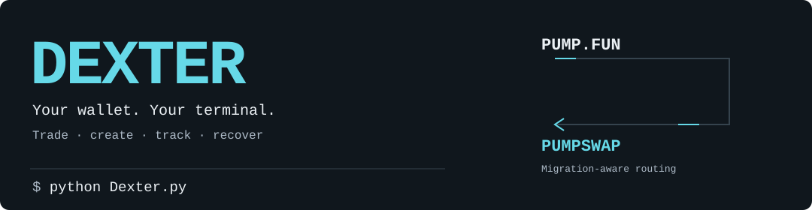

<picture>
  <source media="(max-width: 600px)" srcset="docs/assets/dexter-banner-compact.svg">
  
</picture>

<p align="center">
  <a href="https://github.com/FLOCK4H/Dexter/stargazers"></a>
  <a href="https://github.com/FLOCK4H/Dexter/fork"></a>
  <a href="https://github.com/FLOCK4H/Dexter/issues"></a>
  <a href="https://github.com/FLOCK4H/Dexter/actions"></a>
</p>

<p align="center">
  <a href="#quick-start"></a>
  <a href="docs/commands.md"></a>
  <a href="bindings/README.md"></a>
  <a href="#troubleshooting"></a>
</p>

**Dexter is a standalone Solana trading terminal.** Follow creator activity, run
trading sessions, launch tokens, and recover positions from one compact workspace.
Pump.fun and PumpSwap market logic ships in a versioned Rust binding. You bring
your wallet and RPCs; Dexter handles the terminal workflow.

**Windows x64 · Python 3.10+ · tested on Python 3.12 · v3.1**

## Quick start

New checkout? Follow the [download and installation guide](docs/install.md).

Open a terminal in this repository:

```powershell
python Dexter.py
```

First launch prepares `.venv`, installs the bundled market binding and Python
dependencies, and creates your private `.env` from [`.env.example`](.env.example).
An existing `.env` is preserved. Internet access is needed for the initial install;
Rust and another repository are not needed to run the Windows build.

1. Open **Settings → Quick Setup**. Add your wallet key and HTTP/WebSocket RPCs.
2. Choose **Check setup** to check the wallet, providers, database and paths.
3. Choose **Start Dexter** to run your saved network, mode and strategy.

The default opens the home screen in **simulate** mode with mainnet sending locked.
The bundled native wheel supports Windows x64. Linux/macOS need matching wheels;
see [platform support and binding builds](bindings/README.md).

<details>
<summary><strong>Explore the home screen</strong></summary>

| Action | What it does |
| --- | --- |
| **Start Dexter** | Launches the trader using saved settings. |
| **Positions** | Opens tracked positions, pending recovery and manual exits. |
| **Create token** | Guides a Pump.fun launch or attaches an existing position. |
| **Market data & tasks** | Opens collector, creator analysis and per-run choices. |
| **Settings** | Puts everyday setup first, with strategy and advanced pages deeper. |
| **Check setup** | Checks readiness and prepares the configured local database. |
| **Help** | Opens scrollable mode, control and recovery guidance. |

The header keeps network, mode, send status and wallet visible. Larger windows add
balance and open-position count. Use arrows or `j` / `k`, Enter, shortcut letters,
or click a row. `/` searches; Esc clears search, then returns. Long messages scroll
with arrows, Page Up/Down and Home/End. Minimum size: **44 × 13**; **80 × 24** is
comfortable.

</details>

## Built for the whole position

| Capability | Behavior |
| --- | --- |
| **Creator research** | Collect activity, analyze creators and maintain a leaderboard. |
| **Pump.fun + PumpSwap** | Resolve the current venue when building a buy or sell. |
| **Migration continuity** | Keep the held amount and recovery record as the route changes to PumpSwap. |
| **Token creation** | Plan or execute a launch, with optional follow-up trading. |
| **Recovery** | Keep known signatures and unresolved positions available for reconciliation. |
| **Operator tools** | Inspect, replay, export and backtest through the CLI. |

When a token migrates while held, Dexter refreshes its route for the next exit.
A pending migration or uncertain RPC result keeps the position available for
recovery. Closing Dexter preserves positions by default; automatic liquidation
on shutdown is opt-in.

<div align="center">

  

</div>

## Make it yours

The first section of `.env` contains the everyday controls. The same choices are
available in **Settings → Quick Setup**.

| Setting | Purpose |
| --- | --- |
| `PRIVATE_KEY` | Your base58 Solana keypair. |
| `HTTP_URLS` / `WS_URLS` | Comma-separated providers in failover order, all on one network. |
| `DEXTER_NETWORK` | `mainnet` or `devnet`; devnet uses isolated devnet endpoints. |
| `DEXTER_RUNTIME_MODE` | `read_only`, `paper`, `simulate` or `live`. |
| `AMOUNT_BUY_TL_1` / `AMOUNT_BUY_TL_2` | Buy size in USD notional, before fees and account rent. |
| `DEXTER_START_ACTION` | `menu`, `trade`, `collector`, `analyze` or `doctor`. |
| `DEXTER_AUTO_SETUP` | Prepare the Python environment on launch. |
| `DEXTER_AUTO_DATABASE` | Start or prepare the local database before runtime launch. |

Optional `HTTP_URL` / `WS_URL` values override the primary providers. Leave them
blank to use the first list entries. Shell environment values override file values;
`DEXTER_TRADING_PRIVATE_KEY` can select a separate signer. Dexter reads its own
configuration and never inherits another project's `.env`.

<details>
<summary><strong>Set up PostgreSQL</strong></summary>

The home screen opens without a database connection. Trading and data collection
need PostgreSQL. If PostgreSQL 17 is installed, **Check setup** can prepare an
isolated Dexter cluster and credentials under `.dexter/`, then check readiness:

```powershell
python Dexter.py setup
```

If PostgreSQL binaries are missing, use **Settings → Local database** or:

```powershell
python Dexter.py database-setup
```

Installation may request Windows administrator access. Dexter uses an available
port in the 55432 range and keeps other clusters separate. To use your own database,
set `DATABASE_URL` and, when schema bootstrap needs it, `POSTGRES_ADMIN_DSN`.
Explicit database configuration is preserved. Set `DEXTER_AUTO_DATABASE=false`
to manage database lifecycle yourself.

</details>

<details>
<summary><strong>Choose an execution mode</strong></summary>

| Mode | Behavior |
| --- | --- |
| `read_only` | Observes without opening or closing positions. |
| `paper` | Runs strategy logic with local simulated positions and PnL. |
| `simulate` | Builds and simulates transactions without broadcasting trades. |
| `live` | Sends on devnet; mainnet requires both explicit gates below. |

Real mainnet sending requires all three settings:

```dotenv
DEXTER_RUNTIME_MODE=live
DEXTER_ALLOW_MAINNET_LIVE=true
DEXTER_MAINNET_DRY_RUN=false
```

Trade caps, reserve floor, slippage, fees and strategy controls live in Settings
and the advanced `.env` sections. A one-cent buy still incurs transaction fees and
may require temporary token-account rent.

</details>

## Troubleshooting

<details>
<summary><strong>Check readiness without submitting a trade</strong></summary>

```powershell
python Dexter.py --diagnostics
python Dexter.py doctor --component trader
python Dexter.py verify-migration --network devnet
```

The migration command runs a deterministic harness. It checks position continuity
and an exit through the migrated venue without waiting for a live migration.

</details>

<details>
<summary><strong>Repair dependencies or bindings</strong></summary>

```powershell
python dexter_bootstrap.py --repair
```

Setup details go to `.dexter/setup.log`. Repair preserves `.env` and recovery
files. For manual setup, use `pip install -e .`, install the matching wheel from
`bindings/wheels/`, and set `DEXTER_AUTO_SETUP=false`.

</details>

<details>
<summary><strong>Understand a WebSocket reconnect</strong></summary>

HTTP and WebSocket providers are separate. Changing `HTTP_URLS` does not change
the feed selected by `WS_URLS`. The connection log identifies the stream and
provider host without printing RPC credentials.

Snapshot writes run periodically outside the receive path, and periodic SOL-price
HTTP requests run off the event loop. Heartbeats remain enabled: the defaults are
20 seconds between pings, a 30-second pong deadline, and 15 seconds for subscription
acknowledgement. The advanced overrides are:

```dotenv
DEXTER_WS_PING_INTERVAL_SECONDS=20
DEXTER_WS_PING_TIMEOUT_SECONDS=30
DEXTER_WS_SUBSCRIBE_TIMEOUT_SECONDS=15
```

Reconnect warnings include the reason, connection age, ping RTT and measured
event-loop delay. Transport failures, rejected subscriptions and clean server
closes rotate the provider pool. Cancellation and application processing errors
leave healthy providers in place. See the [WebSocket keepalive guide](https://websockets.readthedocs.io/en/15.0/topics/keepalive.html)
for how load and latency affect heartbeat deadlines.

</details>

## Build with Dexter

[](docs/commands.md)
[](bindings/README.md)
[](https://github.com/FLOCK4H/Dexter/issues/new)

Run the offline suite after preparing the environment:

```powershell
.venv\Scripts\python.exe -m unittest discover -s tests
```

Protocol changes are maintained upstream and shipped as versioned
`dexter-market-sdk` wheels. The [binding guide](bindings/README.md) records the
pinned source, checksums and maintainer build/update workflow. Normal users update
Dexter's packaged binding.

**Repository hygiene:** commit source, `.env.example`, docs and the public binding.
For automated setup and source discovery, use the [plain-text documentation index](llms.txt).

Private `.env` files, `.venv/`, `.dexter/`, `dev/`, logs, database data and recovery
state are ignored. Start with your own local configuration after cloning.
